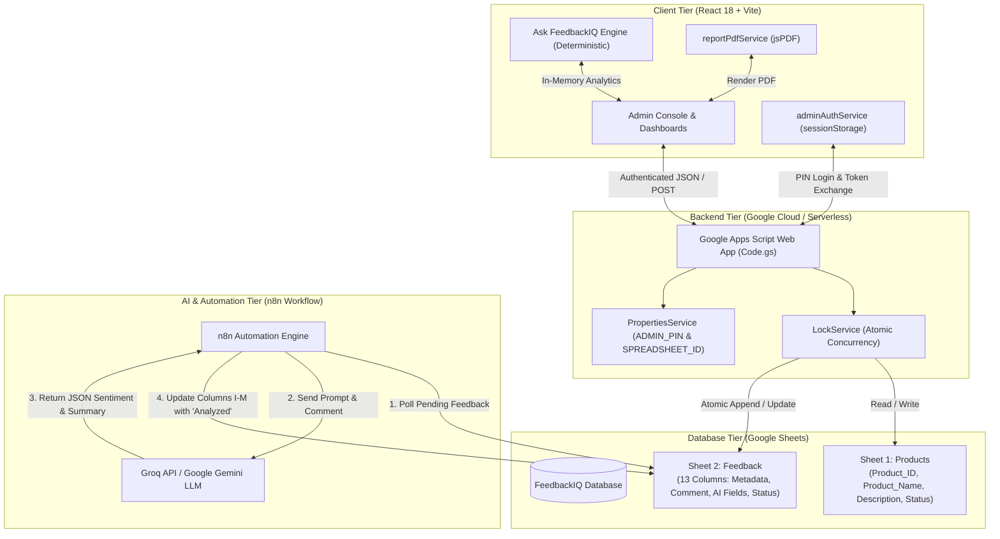
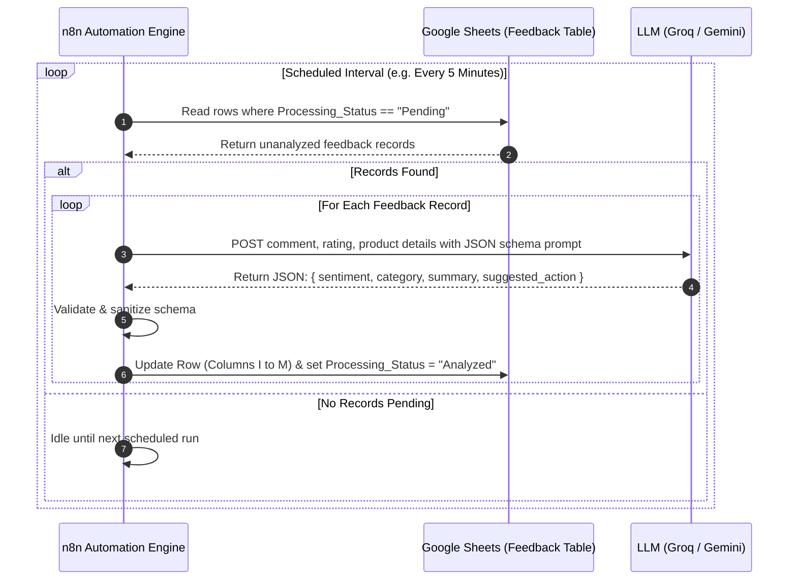

# FeedbackIQ — AI-Powered Customer Feedback Analysis and Intelligence Platform

> **Transforming raw, unstructured customer feedback into structured, actionable business intelligence with automated NLP pipelines and zero-cost cloud architecture.**

---

## Table of Contents

1. [Project Overview](#project-overview)
2. [Problem Statement](#problem-statement)
3. [Project Objectives](#project-objectives)
4. [Key Features](#key-features)
5. [Technology Stack](#technology-stack)
6. [System Architecture](#system-architecture)
7. [n8n Workflow Automation](#n8n-workflow-automation)
8. [Project Folder Structure](#project-folder-structure)
9. [Installation and Setup](#installation-and-setup)
10. [Environment Variables](#environment-variables)
11. [n8n Workflow Import Instructions](#n8n-workflow-import-instructions)
12. [Application Screenshots](#application-screenshots)
13. [Security Considerations](#security-considerations)
14. [Future Enhancements](#future-enhancements)
15. [Conclusion](#conclusion)
16. [Author & Project Information](#author--project-information)

---

## 1. Project Overview

**FeedbackIQ** is a comprehensive, production-ready customer feedback intelligence platform designed to bridge the gap between qualitative customer opinions and executive decision-making. 

Modern businesses receive customer feedback across diverse channels—online reviews, customer support surveys, product ratings, and support tickets. However, organizations struggle to derive timely, unbiased, and actionable insights from this high-volume unstructured text.

FeedbackIQ solves this challenge by pairing a modern React-based administrative console with an automated background enrichment pipeline. Feedback records are stored in a relational Google Sheets database, automatically analyzed and enriched via an **n8n workflow** powered by state-of-the-art Large Language Models (**Groq / Google Gemini**), and served to decision-makers through an executive analytics dashboard, deep product diagnostic views, a deterministic evidence-grounded AI query assistant, and publication-ready PDF reports.

---

## 2. Problem Statement

Traditional customer feedback management suffers from critical operational limitations:

1. **Qualitative Data Overload:** Teams are inundated with voluminous customer comments. Manually reading, tagging, and summarizing thousands of records is slow, labor-intensive, and cost-prohibitive.
2. **Analysis Latency:** Critical product defects, shipping regressions, or sudden negative sentiment shifts often take weeks to surface through quarterly reports, resulting in customer churn.
3. **Subjective & Inconsistent Categorization:** Human tagging varies widely between team members, creating fragmented category classifications and obscuring systemic cross-product patterns.
4. **Lack of Actionability:** Traditional survey tools report numerical Net Promoter Scores (NPS) or star ratings without explaining *why* customers feel that way or *what concrete actions* engineering, operations, or marketing teams should take.
5. **Prohibitive Infrastructure Costs:** Enterprise sentiment analysis suites typically require complex cloud infrastructure, dedicated databases, and expensive recurring subscription licenses.

---

## 3. Project Objectives

- **Centralize Feedback Ingestion:** Provide seamless data collection through public-facing respondent desks and batch file imports (CSV and Excel formats).
- **Automate NLP Enrichment:** Automatically classify multi-class sentiment, categorize feedback into standardized business domains, generate concise summaries, and prescribe actionable next steps without human intervention.
- **Deliver Real-Time Executive Analytics:** Present dynamic Key Performance Indicators (KPIs), rating distributions, volume trends, and cross-product benchmarks on a unified dashboard.
- **Facilitate Deep Product Investigation:** Empower product managers to investigate individual product lines, filter by rating or sentiment, and inspect raw feedback alongside AI conclusions.
- **Provide Hallucination-Free Querying:** Offer an interactive, natural-language query assistant ("Ask FeedbackIQ") that operates strictly over verified live database facts with zero AI hallucinations.
- **Generate Publication-Grade PDF Reports:** Enable one-click client-side generation of executive PDF reports adhering to strict A4 print geometry with automatic page splitting and running headers.
- **Ensure Enterprise Security:** Enforce server-side PIN authentication, brute-force throttling, formula injection protection, and zero client-side secret exposure on a zero-cost serverless backend.

---

## 4. Key Features

Every feature listed below is fully implemented and operational in the FeedbackIQ codebase:

### 1. Executive Dashboard & Analytics (`/dashboard`)
- **Live KPI Grid:** Real-time metrics for Total Feedback, Average Rating, Positive/Negative/Neutral/Mixed breakdown, and Pending vs. Analyzed processing status.
- **Dynamic Feedback Volume Trend:** Interactive time-series line chart tracking submission volume over 7-day, 30-day, 90-day, or All-Time horizons.
- **Rating Distribution Analysis:** Visual bar breakdown across 1-star to 5-star customer ratings.
- **Sentiment & Category Breakdowns:** Visual distribution charts displaying sentiment proportions and operational category shares.
- **Recent Feedback Stream:** Live feed displaying the latest customer feedback submissions with rating stars, sentiment badges, and timestamps.
- **Cross-Product Benchmark Table:** Comparative table comparing total volume, average rating, and positive sentiment ratio across all registered products.

### 2. Product Registry & Management (`/products`)
- **Dynamic Product Registry:** Manage active products dynamically; the platform automatically adapts to any product catalog.
- **Add Product Workflow:** Register new products with auto-generated unique IDs (`PROD-XXX`) and server-side duplicate prevention.
- **Safe Product Removal:** Soft-deactivate products by updating their status to `Inactive`. **Historical feedback records, AI summaries, sentiments, and Response IDs are 100% preserved.**
- **Registry Filtering:** Quickly toggle between Active Products, Inactive/Archived Products, and All Products.

### 3. Customer Feedback Audit Log (`/history`)
- **Multi-Parameter Filtering:** Query feedback records by Product, Sentiment, Category, Rating, Processing Status, and Calendar Date ranges.
- **Full-Text Search:** Search across customer comments, respondent names, and generated summaries.
- **Paginated Data Table:** Smooth navigation across large feedback datasets.
- **Feedback Detail Modal:** In-depth record inspection displaying respondent metadata, rating, raw feedback text, assigned sentiment, category, AI summary, and AI suggested action.

### 4. Batch Data Import Suite (`/import`)
- **Multi-Format Support:** Ingest feedback datasets from CSV and Excel (`.xlsx`, `.xls`) files directly in the browser via PapaParse and SheetJS.
- **Interactive Column Mapping:** Intelligent column matching with customizable dropdown mappers for Product, Rating, Comment, Date, and Respondent fields.
- **Pre-Upload Data Validation:** In-browser schema validation detecting invalid ratings, blank comments, date errors, and duplicate entries.
- **Batch Apps Script Upload:** Atomic ingestion into Google Sheets with LockService collision handling.

### 5. Multi-Class Sentiment & Category Classification
- **Granular Sentiment Scale:** Classifies feedback into `Positive`, `Negative`, `Neutral`, `Mixed`, and `Unclear`.
- **Standardized Category Taxonomy:** Classifies submissions into 9 core business domains:
  - *Product Quality*
  - *Pricing*
  - *Delivery*
  - *Customer Support*
  - *Usability*
  - *Performance*
  - *Features*
  - *Packaging*
  - *Other*

### 6. AI Insights Dashboard (`/insights`)
- **Portfolio-Level Intelligence:** Management-oriented intelligence dashboard synthesizing organizational sentiment patterns.
- **Praise & Pain Points:** Automated clustering identifying recurring customer delights and critical operational friction areas.
- **Product-to-Product Sentiment Comparison:** Comparative cross-product sentiment analysis revealing leaders and laggards.
- **Actionable Business Recommendations:** Prescriptive guidance partitioned into 4 distinct organizational streams:
  1. *Product Quality & Design Improvements*
  2. *Performance & Reliability Improvements*
  3. *Customer Experience Improvements*
  4. *Marketing & Communication Opportunities*

### 7. Interactive Query Assistant ("Ask FeedbackIQ")
- **Evidence-Grounded Query Engine:** Deterministic natural language questioning engine running directly over live database records.
- **Zero Hallucination:** Computes answers strictly from verified database records within the currently selected product and date scope.
- **Domain Guardrails:** Automatically detects and rejects out-of-domain queries (e.g., general world knowledge, programming, weather) with clear guidance.
- **Conversation Persistence:** Retains chat history across background refreshes while properly detecting genuine dataset shifts.

### 8. Individual Product Deep-Dive (`/analysis`)
- **Product-Centric Investigation:** Dedicated investigative console tailored for product managers to drill down into a single product.
- **Product Health Metrics:** Specific product KPIs, rating breakdowns, and sentiment distributions.
- **Targeted Feedback Exploration:** Filterable table of feedback records specific to the selected product.

### 9. Publication-Grade Executive PDF Reports (`/reports`)
- **Client-Side Generation:** Generates multi-page executive PDF reports in the browser using jsPDF without external server rendering costs.
- **Deterministic A4 Pagination:** Strict A4 printable boundaries (210 × 297mm, 14mm margins) with dynamic text-wrapping (`splitTextToSize`).
- **Zero Overflow & Overlap:** Dynamic row and section height calculations prevent text clipping and overlapping.
- **Professional Document Layout:** Includes running headers, repeating table headers across page breaks, and "Page X of Y" footers.
- **Configurable Report Sections:** Select custom date ranges, target product scopes, and toggle individual report sections on or off.

### 10. Settings & Preferences (`/settings`)
- **Analytics Horizon Preference:** Configure the default reporting horizon (`7 Days`, `30 Days`, `90 Days`, `All Time`) stored in localStorage.
- **Nordic Obsidian Design System:** Seamless switching between `Light`, `Dark`, and `System` appearance themes.

### 11. Admin Profile & Security Settings (`/profile`)
- **Profile Overview:** Initials-based avatar, administrator display name, email, role indicator, and active status.
- **Personal Information Editor:** Update administrative display name and email address with server and local persistence.
- **Server-Enforced PIN Change:** Update the administrator PIN securely via Google Apps Script `PropertiesService`; PINs are never stored on the client.
- **Session Lifetime Monitor:** Inspect active session establishment time, sliding expiration timestamp, and trigger secure sign-out.

---

## 5. Technology Stack

| Layer | Technology | Purpose |
| :--- | :--- | :--- |
| **Frontend Framework** | **React 18** (`react`, `react-dom`) | Component-based user interface architecture |
| **Build Tool & Dev Server** | **Vite 5** (`vite`, `@vitejs/plugin-react`) | High-performance ES module bundler and fast HMR |
| **Routing** | **React Router 6** (`react-router-dom`) | Client-side routing, route protection, and navigation |
| **Styling & Design System** | **Tailwind CSS 3** (`tailwindcss`, `postcss`) | Utility-first CSS implementing the *Nordic Obsidian* theme |
| **UI Components & Icons** | **Lucide React** (`lucide-react`) | Crisp, accessible iconography across all dashboards |
| **Data Visualizations** | **Recharts 2** (`recharts`) | Responsive SVG charts (Line, Bar, Pie, Category charts) |
| **Animations** | **Framer Motion 11** (`framer-motion`) | Smooth transitions, modal animations, and interactive cards |
| **Client File Parsing** | **PapaParse 5** & **SheetJS 0.18** (`xlsx`) | In-browser parsing of CSV and Excel spreadsheets |
| **PDF Generation** | **jsPDF 2.5** & **html2canvas 1.4** | Client-side vector-based executive PDF report exporter |
| **Backend API Layer** | **Google Apps Script** (GAS) | Serverless REST API Web App handling auth, data, and locks |
| **Database & Storage** | **Google Sheets** | Relational cloud spreadsheet database (`Products`, `Feedback`) |
| **Concurrency Management** | **Apps Script LockService** | Atomic row operations preventing concurrent write collisions |
| **Secret Management** | **GAS PropertiesService** | Secure server-side storage for `ADMIN_PIN` and `SPREADSHEET_ID` |
| **Workflow Automation** | **n8n** | Low-code workflow automation orchestrating AI feedback analysis |
| **AI & NLP Inference** | **Groq API / Google Gemini** | High-speed LLM inference for sentiment, category, summary, and actions |

---

## 6. System Architecture

FeedbackIQ utilizes a decoupled, modern architecture separating presentation, serverless API execution, relational cloud storage, and background AI orchestration.



### Data Flow Lifecycle

1. **Ingestion:** Feedback is submitted via the public form or imported via CSV/Excel through `/import`. Apps Script acquires a lock via `LockService`, validates the data, generates a unique `Response_ID` (`RESP-YYYYMMDD-HHMMSS-XXXX`), and appends the row with `Processing_Status: 'Pending'`.
2. **AI Enrichment:** The **n8n workflow** periodically polls the `Feedback` sheet for rows where `Processing_Status = 'Pending'`. It batches the records and prompts the **Groq / Gemini LLM** to return structured JSON containing sentiment, category, summary, and suggested action.
3. **Database Write-Back:** n8n writes the analysis directly into Columns I through M of the spreadsheet, setting `Processing_Status: 'Analyzed'`.
4. **Analytics Retrieval:** When an administrator visits the dashboard, `useDashboardData` authenticates via `adminAuthService` and retrieves live enriched rows from Apps Script.
5. **Interactive Querying & Reporting:** The frontend calculates KPIs, renders charts, executes deterministic queries via `askFeedbackIQEngine.js`, and generates executive PDF reports via `reportPdfService.js`.

---

## 7. n8n Workflow Automation

The automated AI feedback analysis is powered by an **n8n workflow**. n8n acts as an event-driven middleware connecting the Google Sheets database to the AI inference provider.



### Workflow Node Sequence:
1. **Schedule Trigger:** Triggers every $N$ minutes (or upon webhook invocation).
2. **Google Sheets Node (Read):** Queries the `Feedback` sheet for rows where `Processing_Status` equals `'Pending'`.
3. **Code / Batching Node:** Extracts `Response_ID`, `Product_Name`, `Rating`, and `Comment`.
4. **HTTP Request / AI Node:** Sends structured prompt instructions to the LLM endpoint (Groq Llama-3 or Gemini):
   ```json
   {
     "sentiment": "Positive | Negative | Neutral | Mixed",
     "category": "Product Quality | Pricing | Delivery | Customer Support | Usability | Performance | Features | Packaging | Other",
     "summary": "Concise 1-sentence synopsis",
     "suggested_action": "Specific concrete operational recommendation"
   }
   ```
5. **JSON Parse & Validation:** Ensures the model output matches expected enumeration values.
6. **Google Sheets Node (Update):** Writes `Sentiment`, `Category`, `Summary`, `Suggested_Action`, and sets `Processing_Status = 'Analyzed'` into the corresponding row.

> [!NOTE]
> The n8n workflow operates independently from the React frontend. It can be hosted on n8n Cloud, self-hosted via Docker, or run locally via npm. Workflow definitions can be exported and imported as JSON files.

---

## 8. Project Folder Structure

```
FeedbackIQ/
├── apps-script/                 # Google Apps Script backend source files
│   ├── AdminFeedback.gs         # Protected feedback retrieval with date/product filtering
│   ├── Auth.gs                  # Server-side PIN verification, session tokens & lockout
│   ├── Code.gs                  # Main doPost / doGet routing & JSON response builder
│   ├── Config.gs                # Sheet schemas, validation limits & spreadsheet binder
│   ├── Feedback.gs              # Public feedback submission & validation logic
│   ├── Import.gs                # Batch CSV/Excel data import & atomic sheet insertion
│   ├── Products.gs              # Product registry management (fetch, add, soft-remove)
│   ├── Utils.gs                 # Formula injection sanitization & string utilities
│   └── Validation.gs            # Input validation routines (lengths, ratings, emails)
├── docs/                        # Architecture & operations documentation
│   ├── PHASE_6A_SETUP.md        # Phase 6A Google Sheets & Apps Script deployment guide
│   └── PHASE_6B_SETUP.md        # Phase 6B Admin Auth & Dashboard setup guide
├── public/                      # Static assets
│   └── favicon.svg              # FeedbackIQ brand icon
├── src/                         # React frontend source code
│   ├── components/              # Modular UI components
│   │   ├── analysis/            # Product Analysis components (KPIGrid, CategoryBreakdown)
│   │   ├── animations/          # RevealOnScroll, SpotlightCard visual wrappers
│   │   ├── auth/                # RequireAdminAuth route guard
│   │   ├── dashboard/           # Dashboard widgets (KPIGrid, TrendChart, RatingChart)
│   │   ├── history/             # Feedback History table, filters, and detail modal
│   │   ├── import/              # Batch import UI (ColumnMapper, ValidationSummary)
│   │   ├── insights/            # AI Insights cards, PraiseAndPainPoints, AskFeedbackIQ
│   │   ├── landing/             # Public landing page sections (Hero, Features, CTA)
│   │   ├── layout/              # Top Navbar, Footer
│   │   ├── reports/             # PDF report configuration form and live preview
│   │   └── ui/                  # Reusable atomic UI (Button, Modal, Badge, Card, Spinner)
│   ├── config/                  # Global application constants & design tokens
│   │   └── constants.js         # Routes, palettes, sentiments, categories, rating labels
│   ├── context/                 # React Context providers
│   │   └── ThemeContext.jsx     # Global theme provider (Light / Dark / System)
│   ├── data/                    # Pure calculation & data transformation utilities
│   │   └── mockDashboardData.js # Metric aggregation functions (KPIs, trends, ratings)
│   ├── hooks/                   # Custom React hooks
│   │   ├── useDashboardData.js   # Live Google Sheets data fetching & caching
│   │   ├── useDashboardFilters.js# Shared product & date range filter state
│   │   └── useTheme.js          # Theme switcher hook interacting with localStorage & DOM
│   ├── lib/                     # Helper libraries
│   │   └── utils.js             # Tailwind class merging utility (clsx / twMerge)
│   ├── pages/                   # Application route views
│   │   ├── AdminLoginPage.jsx   # PIN-based admin authentication page
│   │   ├── AdminProfilePage.jsx # Administrator profile & security credentials manager
│   │   ├── AIInsightsPage.jsx   # Organization-level AI intelligence & Ask FeedbackIQ
│   │   ├── DashboardPage.jsx    # Primary executive KPI dashboard
│   │   ├── FeedbackHistoryPage.jsx # Filterable audit log of all customer submissions
│   │   ├── ImportDataPage.jsx   # Batch CSV / Excel file import suite
│   │   ├── LandingPage.jsx      # Public product landing page
│   │   ├── ManageProductsPage.jsx # Product catalog management (Add / Soft-Remove)
│   │   ├── ProductAnalysisPage.jsx# Single-product deep-dive investigative console
│   │   ├── ReportsPage.jsx      # Executive PDF report builder and exporter
│   │   └── SettingsPage.jsx     # Preferences and appearance settings
│   ├── services/                # API and data service layers
│   │   ├── adminAuthService.js  # Token management, login, logout & profile API calls
│   │   ├── adminDataService.js  # Authenticated Apps Script API client
│   │   ├── productService.js    # Product normalization utilities
│   │   ├── reportDataService.js # Data preparation & synthesis for PDF reports
│   │   └── reportPdfService.js  # Publication-grade jsPDF layout & pagination engine
│   ├── styles/                  # Global style sheets
│   │   └── globals.css          # Tailwind CSS directives & CSS custom properties
│   ├── utils/                   # Domain engines & parsers
│   │   ├── askFeedbackIQEngine.js# Deterministic Ask FeedbackIQ query engine
│   │   └── fileImportParser.js  # Client-side CSV/XLSX file parser and validator
│   ├── App.jsx                  # Main router and route protection tree
│   └── main.jsx                 # Application entry point mounting ThemeProvider
├── .env.example                 # Template for local environment variables
├── .gitignore                   # Git ignore rules for node_modules, secrets, and build files
├── index.html                   # HTML template
├── package.json                 # Project dependencies and npm scripts
├── postcss.config.js            # PostCSS configuration for Tailwind CSS
├── tailwind.config.js           # Tailwind CSS design system configuration
└── vite.config.js               # Vite project configuration
```

---

## 9. Installation and Setup

Follow these step-by-step instructions to set up FeedbackIQ locally:

### Prerequisites
- **Node.js**: Version 18.x or later installed on your system.
- **npm**: Version 9.x or later.
- **Google Account**: For Google Sheets and Google Apps Script.
- **n8n Instance**: n8n Desktop, n8n Cloud, or self-hosted Docker instance.
- **Groq or Google Gemini API Key**: For LLM analysis.

### Step 1: Clone the Repository
```bash
git clone https://github.com/<your-username>/FeedbackIQ.git
cd FeedbackIQ
```

### Step 2: Install Node Dependencies
```bash
npm install
```

### Step 3: Configure Google Sheets Database
1. Create a new Google Spreadsheet at [sheets.new](https://sheets.new).
2. Name the spreadsheet: `FeedbackIQ Database`.
3. Note the **Spreadsheet ID** from the URL:
   `https://docs.google.com/spreadsheets/d/<SPREADSHEET_ID>/edit`
4. Create two sheets with the following exact tab names and headers:
   - **Tab 1: `Products`**
     - Row 1 Headers: `Product_ID`, `Product_Name`, `Description`, `Status`
     - Example Row: `PROD-001 | Laptop X | Flagship Laptop | Active`
   - **Tab 2: `Feedback`**
     - Row 1 Headers (13 exact columns across A to M):
       `Response_ID`, `Timestamp`, `Product_ID`, `Product_Name`, `Respondent_Name`, `Is_Anonymous`, `Rating`, `Comment`, `Sentiment`, `Category`, `Summary`, `Suggested_Action`, `Processing_Status`

### Step 4: Deploy Google Apps Script API
1. In your Google Sheet, navigate to **Extensions** → **Apps Script**.
2. Create script files matching the files in the [`apps-script/`](apps-script/) directory:
   - `Code.gs`, `Config.gs`, `Auth.gs`, `Products.gs`, `Feedback.gs`, `AdminFeedback.gs`, `Import.gs`, `Utils.gs`, `Validation.gs`.
3. Go to **Project Settings** (gear icon ⚙️) → **Script Properties** and add:
   - `SPREADSHEET_ID`: Your Google Spreadsheet ID.
   - `ADMIN_PIN`: A secure PIN of your choice (e.g., `Admin@2026!`).
4. Click **Deploy** → **New Deployment**.
   - Select type: **Web App**.
   - Description: `FeedbackIQ Production API`.
   - Execute as: **Me**.
   - Who has access: **Anyone** (required for public submissions and frontend POST requests).
5. Copy the generated **Web App URL** (`https://script.google.com/macros/s/.../exec`).

### Step 5: Configure Local Environment Variables
Create a `.env.local` file in the root directory by copying the example:
```bash
cp .env.example .env.local
```

Edit `.env.local` and set your Apps Script URL:
```env
VITE_APPS_SCRIPT_URL=https://script.google.com/macros/s/YOUR_DEPLOYMENT_ID/exec
VITE_GEMINI_MODEL=gemini-3.8-flash
```

### Step 6: Start the Development Server
```bash
npm run dev
```
Open your browser and navigate to:
```
http://localhost:5173
```

### Step 7: Build for Production
To create an optimized production build:
```bash
npm run build
```
To preview the production build locally:
```bash
npm run preview
```

---

## 10. Environment Variables

FeedbackIQ strictly separates configuration from code. Sensitive administrative secrets reside exclusively inside Google Apps Script `Script Properties` and are never exposed to client browsers or committed to Git.

### Frontend Environment Variables (`.env.local`)
| Variable | Required | Description |
| :--- | :---: | :--- |
| `VITE_APPS_SCRIPT_URL` | **Yes** | Google Apps Script Web App deployment endpoint (`https://script.google.com/macros/s/.../exec`). |
| `VITE_GEMINI_MODEL` | No | Public model identifier used for reference (Defaults to `gemini-3.8-flash`). |

### Backend Script Properties (Google Apps Script)
Configured inside Google Apps Script: **Project Settings** → **Script Properties**:
| Property Name | Required | Description |
| :--- | :---: | :--- |
| `SPREADSHEET_ID` | **Yes** | The Google Sheet ID of the `FeedbackIQ Database`. |
| `ADMIN_PIN` | **Yes** | The secret master PIN required to authenticate admin sessions and authorize changes. |
| `ADMIN_NAME` | No | Optional display name for the administrator profile (Defaults to `System Administrator`). |
| `ADMIN_EMAIL` | No | Optional contact email for the administrator profile (Defaults to `admin@feedbackiq.local`). |

### Safe `.env.example` Template
```env
# Google Apps Script Web App Deployment URL
# Directs public form submissions and authenticated dashboard requests
VITE_APPS_SCRIPT_URL=https://script.google.com/macros/s/YOUR_DEPLOYMENT_ID/exec

# Gemini Model Identifier (Non-sensitive configuration)
VITE_GEMINI_MODEL=gemini-3.8-flash
```

---

## 11. n8n Workflow Import Instructions

To automate AI sentiment and category analysis using n8n:

1. **Launch n8n:** Open your n8n web interface (e.g., `http://localhost:5678` or your n8n Cloud dashboard).
2. **Import Workflow:**
   - Click **Workflows** in the left sidebar.
   - Click the **...** menu (top-right) and select **Import from File** (or drag and drop your exported `FeedbackIQ-n8n-Workflow.json`).
3. **Configure Google Sheets Credential:**
   - Open the **Google Sheets** nodes in the workflow canvas.
   - Under **Credential for Google Sheets**, link your Google OAuth2 account or Service Account with read/write access to your `FeedbackIQ Database` spreadsheet.
   - Select your `FeedbackIQ Database` spreadsheet and set the sheet name to `Feedback`.
4. **Configure LLM API Credential:**
   - Open the **AI / HTTP Request Node** (Groq or Google Gemini).
   - Create a credential for your provider and enter your API key securely.
5. **Test Workflow:**
   - Click **Test Step** on the Google Sheets read node to verify it reads pending rows.
   - Click **Execute Workflow** to process a test feedback record.
6. **Activate:** Toggle the workflow switch in the top-right corner to **Active**. The workflow will now automatically process incoming feedback on schedule.

---


## 12. Security Considerations

FeedbackIQ is architected with strict enterprise security practices:

- **Zero Client Credential Storage:** The administrator PIN is never stored in browser storage (`localStorage`, `sessionStorage`, or cookies) and is never transmitted in URL parameters.
- **Server-Side Authorization:** The frontend route guard (`RequireAdminAuth`) provides UI convenience; the actual security barrier is enforced server-side by Google Apps Script rejecting any unauthorized action.
- **Brute-Force Throttling:** Apps Script utilizes `LockService` to prevent race conditions on login attempts. After 5 consecutive failed PIN attempts, access is locked out globally for 15 minutes.
- **Session Token Isolation:** Successful authentication issues an unpredictable 64-character session token stored strictly in browser `sessionStorage` (tab-scoped and purged automatically upon closing the tab).
- **Formula Injection Mitigation:** In `apps-script/Utils.gs`, all incoming customer comments and text inputs are sanitized to neutralize spreadsheet formula injection attacks (leading `=`, `+`, `-`, `@`, `\t`, `\r`).
- **Data Integrity on Deactivation:** Removing a product soft-deactivates it by setting its status to `'Inactive'`. Historical feedback records, AI summaries, sentiments, and Response IDs are never deleted or modified.
- **Git Secret Protection:** The repository configuration strictly ignores all `.env`, `.env.local`, and credential files via an explicit `.gitignore`.

---

## 13. Future Enhancements

The following realistic enhancements represent potential future roadmap directions:

- **Multi-Tenant Workspaces:** Support for multiple distinct organizations with isolated database partitions and role-based access control (RBAC).
- **Real-Time Webhook Streaming:** Replace polling triggers with real-time webhooks connecting Google Sheets or direct API endpoints to n8n for sub-second analysis latency.
- **Multi-Language NLP Translation:** Automatically detect and translate customer feedback submitted in international languages prior to sentiment and category classification.
- **Automated Incident Alerts:** Configure automated Slack, Microsoft Teams, or email dispatching when consecutive 1-star ratings or critical safety keywords are detected.
- **Custom AI Prompt Tuning:** Administrative interface allowing organizations to customize the LLM system prompt and define proprietary category taxonomies.

---

## 14. Conclusion

**FeedbackIQ** demonstrates that sophisticated, AI-powered customer intelligence does not require expensive multi-tiered cloud infrastructure or complex enterprise software subscriptions. 

By combining **React 18** and **Tailwind CSS** with serverless **Google Apps Script**, **Google Sheets**, and **n8n workflow automation**, FeedbackIQ delivers an enterprise-grade analytics experience—spanning real-time dashboards, evidence-grounded natural-language querying, batch spreadsheet ingestion, and publication-ready PDF reports—with zero ongoing hosting costs and uncompromising data integrity.

---


