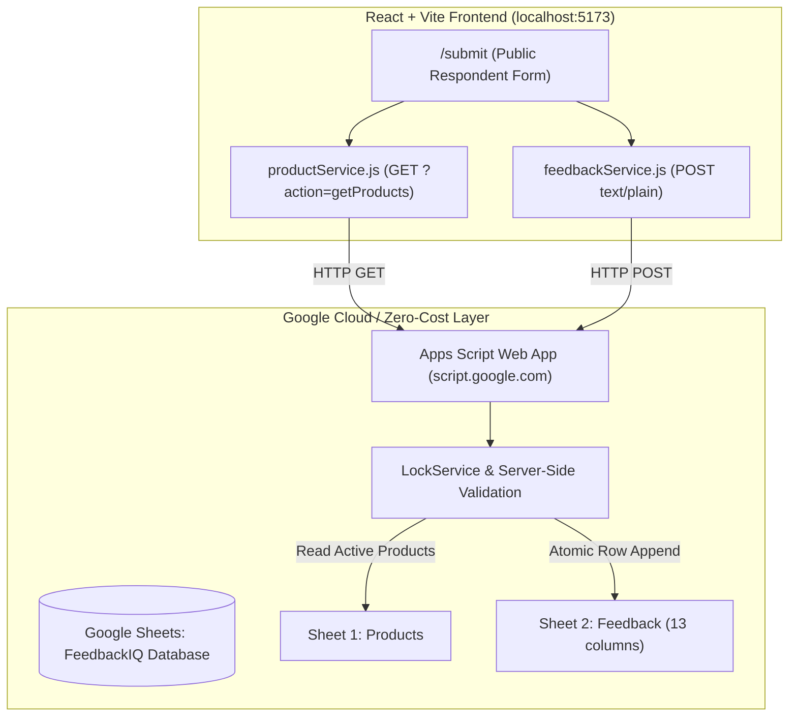

# FeedbackIQ — Phase 6A Setup Guide
## Google Sheets Database & Google Apps Script API Integration

This guide provides step-by-step instructions to create the **FeedbackIQ Database** in Google Sheets, deploy the **Google Apps Script** API layer, and connect it to your local React frontend.

---

## Architecture Overview



---

## Step 1: Create the Google Spreadsheet

1. Open your web browser and go to [Google Sheets](https://sheets.new).
2. Rename the spreadsheet in the top-left title bar to:
   ```
   FeedbackIQ Database
   ```
3. Copy your **Spreadsheet ID** from the browser's address bar. The URL looks like:
   ```
   https://docs.google.com/spreadsheets/d/1A2B3C4D5E6F7G8H9I0J_EXAMPLE_ID/edit
   ```
   The string between `/d/` and `/edit` is your `SPREADSHEET_ID`. Save this string for Step 5.

---

## Step 2: Set Up Sheet 1 — `Products`

1. Rename the initial sheet tab at the bottom from **Sheet1** to:
   ```
   Products
   ```
2. In Row 1, enter these exact column headers across Columns A through D:

| Column | Header | Description |
| :---: | :--- | :--- |
| **A** | `Product_ID` | Unique product identifier (e.g., `PROD-001`) |
| **B** | `Product_Name` | Display name of the product |
| **C** | `Description` | Brief summary of the product |
| **D** | `Status` | `Active` or `Inactive` |

3. In Rows 2 through 4, add the following initial sample records:

| Product_ID | Product_Name | Description | Status |
| :--- | :--- | :--- | :--- |
| `PROD-001` | `Laptop X` | Laptop product feedback | `Active` |
| `PROD-002` | `Mobile Y` | Mobile product feedback | `Active` |
| `PROD-003` | `Headphones Z` | Headphones product feedback | `Active` |

> [!TIP]
> Only rows where `Status` is set to `Active` (case-insensitive) will be sent to the respondent form. To temporarily hide a product without deleting it, change its status to `Inactive`.

---

## Step 3: Set Up Sheet 2 — `Feedback`

1. Click the **+** button at the bottom of Google Sheets to add a second sheet.
2. Rename the new sheet tab to:
   ```
   Feedback
   ```
3. In Row 1, enter the following **13 exact column headers** in order across Columns A through M:

| Column | Header Name | Purpose & Populated By |
| :---: | :--- | :--- |
| **A** | `Response_ID` | Auto-generated ID (`RESP-YYYYMMDD-HHMMSS-XXXX`) by Apps Script |
| **B** | `Timestamp` | ISO 8601 UTC timestamp generated by Apps Script |
| **C** | `Product_ID` | Validated product ID submitted by respondent |
| **D** | `Product_Name` | Official product name retrieved from `Products` sheet |
| **E** | `Respondent_Name` | Optional respondent name (empty if anonymous) |
| **F** | `Is_Anonymous` | `TRUE` or `FALSE` |
| **G** | `Rating` | Integer from `1` to `5` |
| **H** | `Comment` | Validated respondent feedback text |
| **I** | `Sentiment` | Blank initially (populated by Gemini in Phase 8) |
| **J** | `Category` | Blank initially (populated by Gemini in Phase 8) |
| **K** | `Summary` | Blank initially (populated by Gemini in Phase 8) |
| **L** | `Suggested_Action` | Blank initially (populated by Gemini in Phase 8) |
| **M** | `Processing_Status` | Initial value: `Pending` |

---

## Step 4: Open Google Apps Script Editor

1. In your **FeedbackIQ Database** Google Sheet, click the top menu:
   **Extensions** → **Apps Script**.
2. An Apps Script project tab will open.
3. Rename the project at the top from *Untitled project* to:
   ```
   FeedbackIQ API
   ```

---

## Step 5: Add the Modular Apps Script Files

In the left sidebar of the Apps Script editor, click the **+** icon next to **Files** and select **Script** to create each file. Copy the exact code from the project's `apps-script/` folder:

1. **`Config.gs`** (from `apps-script/Config.gs`)
   - Holds sheet names, column mappings, validation limits, and `getSpreadsheet()`.
2. **`Utils.gs`** (from `apps-script/Utils.gs`)
   - Holds JSON response builder, unique ID generator, and formula-injection sanitization.
3. **`Validation.gs`** (from `apps-script/Validation.gs`)
   - Validates ratings (1–5), comment length (10–1000), anonymous sanitization, and product IDs.
4. **`Products.gs`** (from `apps-script/Products.gs`)
   - Reads active products with a single high-efficiency batch range call.
5. **`Feedback.gs`** (from `apps-script/Feedback.gs`)
   - Implements atomic row appending guarded by `LockService`.
6. **`Code.gs`** (from `apps-script/Code.gs`)
   - Router containing `doGet(e)` (health check & products) and `doPost(e)` (feedback submission).

Click the floppy disk **Save project** icon (or press `Ctrl+S`).

---

## Step 6: Configure Script Properties (`SPREADSHEET_ID`)

To keep your Spreadsheet ID private and configurable:

1. In the Apps Script left navigation panel, click **Project Settings** (gear icon ⚙️).
2. Scroll down to the **Script Properties** section.
3. Click **Add script property**.
4. Enter:
   - **Property**: `SPREADSHEET_ID`
   - **Value**: *(Paste your Spreadsheet ID copied in Step 1)*
5. Click **Save script properties**.

---

## Step 7: Deploy as a Public Web App

1. In the top-right corner of the Apps Script editor, click the blue **Deploy** button → **New deployment**.
2. Click the gear icon ⚙️ next to *Select type* and choose **Web app**.
3. Configure the deployment settings:
   - **Description**: `FeedbackIQ API v1.0`
   - **Execute as**: `Me (<your-email>@gmail.com)`
     *(This ensures the script has permission to read and append rows to your Google Sheet without requiring respondents to log into a Google account).*
   - **Who has access**: `Anyone`
     *(This allows public respondents visiting `/submit` to send feedback without authentication).*
4. Click **Deploy**.
5. When prompted with **Authorization required**:
   - Click **Authorize access**.
   - Select your Google account.
   - Click **Advanced** (bottom left of the modal).
   - Click **Go to FeedbackIQ API (unsafe)**.
   - Click **Allow**.
6. Google will display your **Web App URL**. It looks like:
   ```
   https://script.google.com/macros/s/AKfycbz...EXAMPLE.../exec
   ```
7. Click **Copy** to copy the Web App URL.

---

## Step 8: Configure the Local React Application

1. In the `d:\FeedbackIQ` project root, create or edit your `.env.local` file:
   ```env
   # Google Apps Script Web App Deployment URL
   VITE_APPS_SCRIPT_URL=https://script.google.com/macros/s/YOUR_COPIED_DEPLOYMENT_URL/exec

   # Configurable Gemini Model Name
   VITE_GEMINI_MODEL=gemini-3.8-flash
   ```
2. Restart your local Vite development server so Vite loads the new environment variables:
   ```powershell
   npm run dev
   ```

---

## Step 9: Verify the Integration

### 1. Test Endpoint Health in Browser
Open your copied Web App URL directly in any browser tab:
```
https://script.google.com/macros/s/YOUR_URL/exec
```
Expected JSON response:
```json
{
  "success": true,
  "message": "FeedbackIQ API is healthy and connected to Google Sheets.",
  "status": "healthy",
  "sheetsFound": {
    "products": true,
    "feedback": true
  }
}
```

### 2. Test Active Products Retrieval
Add `?action=getProducts` to your Web App URL:
```
https://script.google.com/macros/s/YOUR_URL/exec?action=getProducts
```
Expected JSON response:
```json
{
  "success": true,
  "data": [
    {
      "productId": "PROD-001",
      "productName": "Laptop X",
      "description": "Laptop product feedback"
    },
    {
      "productId": "PROD-002",
      "productName": "Mobile Y",
      "description": "Mobile product feedback"
    },
    {
      "productId": "PROD-003",
      "productName": "Headphones Z",
      "description": "Headphones product feedback"
    }
  ]
}
```

### 3. Test Full Feedback Submission in the UI
1. Open `http://localhost:5173/submit` in your browser.
2. The product dropdown will now load `"Laptop X"`, `"Mobile Y"`, and `"Headphones Z"` directly from your Google Sheet.
3. Select a product, pick a star rating (e.g. 5 stars), and enter a detailed comment (at least 10 characters).
4. Click **Submit Feedback**.
5. The button will display *Submitting Feedback...* while the request is processed.
6. Upon completion, the green confirmation panel will display:
   - **Saved to Google Sheets**
   - **Response ID**: `RESP-YYYYMMDD-HHMMSS-XXXX`
   - **Status**: `Pending`
7. Check your Google Sheet under the **Feedback** tab: You will see the new row with exact columns A through M populated!

---

## Step 10: How to Update Apps Script After Code Modifications

Whenever you edit any `.gs` file in the Apps Script editor:

1. Click **Deploy** → **Manage deployments**.
2. Select your active deployment from the list on the left.
3. Click the **Edit** icon (pencil ✏️) in the top right.
4. Under **Version**, select **New version**.
5. Click **Deploy**.

> [!IMPORTANT]
> If you do not create a **New version** when managing deployments, Google Apps Script will continue executing the old cached version of your code!

---

## Security Boundary & Abuse Prevention Notes

- **Public Endpoint Limitation:** Because respondent submissions are anonymous and unauthenticated, anyone with access to the Web App URL can attempt to submit responses.
- **Data Protection:** The endpoint strictly **never** exposes the `Feedback` sheet rows through GET requests. Respondent names and comments remain private inside Google Sheets.
- **Formula Injection Safeguard:** All respondent text starting with `=, +, -, @` is sanitized with a leading quote (`'`) to ensure Google Sheets treats it as plain text and never executes spreadsheet formulas.
- **Concurrency Protection:** Multiple simultaneous submissions are guarded by `LockService.getScriptLock()` with a 10-second timeout to prevent race conditions and sheet row overwrites.
