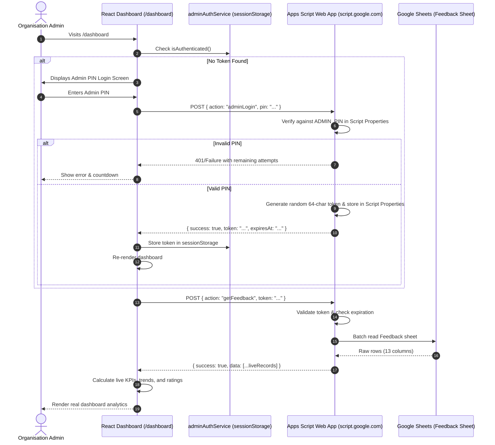

# FeedbackIQ — Phase 6B Setup & Operations Guide
## Real Data Integration & Admin Authentication for Dashboard

This guide provides instructions to update your deployed Google Apps Script backend and run the authenticated, live-data FeedbackIQ administrative dashboard.

---

## 1. What Phase 6B Implements

In Phase 6A, the public feedback submission form was connected to Google Sheets. In Phase 6B:

1. **Admin Authentication Layer:**
   - The admin dashboard is guarded by a server-side PIN authentication system.
   - The PIN is configured securely in Google Apps Script **Script Properties** (never in frontend code or Git).
   - Successful login generates an unpredictable 64-character session token stored in browser `sessionStorage`.
   - Brute-force throttling uses `LockService` to safely prevent race conditions across concurrent login attempts, locking out access after 5 consecutive failed attempts for 15 minutes.
   - `adminLogout` requires a valid session token matching the active session; unauthenticated or mismatched logout requests are rejected.
   - The public `/submit` desk remains completely open and unauthenticated for respondents.

2. **Live Data Dashboard Integration:**
   - The administrative dashboard (`/dashboard`) replaces mock data with live rows from the `Feedback` sheet.
   - Total feedback count, average rating, rating distribution, and volume trends dynamically calculate from real records.
   - Unprocessed feedback correctly shows as **Pending Analysis** for sentiment and category rather than fabricating artificial categories.
   - Sliding 2-hour session expiry is returned on every authenticated response and synchronized with `sessionStorage`.
   - Calendar date-only filters (`dateFrom`, `dateTo`) are strictly validated against impossible calendar dates and evaluated in the spreadsheet's configured timezone (`ss.getSpreadsheetTimeZone()`), ensuring feedback submitted throughout that entire calendar day (including shortly after midnight or late at night) is properly included.
   - A live data freshness bar displays the exact timestamp of the last database query with a one-click manual **Refresh** action, guarded against overlapping request race conditions.
   - Dynamic product and date filters operate against live database records.

---

## 2. Authentication Architecture & Security Model



### Honest Security Disclosures (Academic Demo):
- **Single Active Admin Session:** Apps Script Script Properties are global to the deployment. Logging in from a second browser invalidates the previous session token.
- **Client Session Isolation:** The token is kept strictly in `sessionStorage` (tab-scoped and deleted when the tab closes). It is never written to `localStorage`.
- **Backend Enforcement:** The frontend route guard is a UI convenience; the actual security barrier is enforced by Apps Script rejecting unauthenticated `getFeedback` requests.
- **No IP-Level Rate Limiting:** Google Apps Script Web Apps do not expose caller IP addresses. Throttling is applied globally to PIN attempt counts.
- **Suitability:** This model is designed for a controlled academic capstone demonstration, not multi-tenant corporate production.

---

## 3. Manual Step 1: Configure `ADMIN_PIN` in Apps Script

1. Open your **FeedbackIQ Database** Google Sheet.
2. Click **Extensions** → **Apps Script**.
3. In the left navigation menu, click **Project Settings** (gear icon ⚙️).
4. Scroll down to **Script Properties**.
5. Click **Add script property**:
   - **Property**: `ADMIN_PIN`
   - **Value**: Choose an admin PIN (e.g., `Admin@2026!` or any memorized passphrase).
6. Ensure your existing `SPREADSHEET_ID` property is still present.
7. Click **Save script properties**.

---

## 4. Manual Step 2: Update Apps Script Source Files

In the Apps Script editor left panel, update your project files using the source code in `apps-script/`:

### A. Add New Script File: `Auth.gs`
1. Click **+** next to **Files** → select **Script**.
2. Name it `Auth`.
3. Paste the contents of [`apps-script/Auth.gs`](file:///d:/FeedbackIQ/apps-script/Auth.gs).

### B. Add New Script File: `AdminFeedback.gs`
1. Click **+** next to **Files** → select **Script**.
2. Name it `AdminFeedback`.
3. Paste the contents of [`apps-script/AdminFeedback.gs`](file:///d:/FeedbackIQ/apps-script/AdminFeedback.gs).

### C. Update Existing Script File: `Code.gs`
1. Open `Code.gs`.
2. Replace all existing contents with the updated code from [`apps-script/Code.gs`](file:///d:/FeedbackIQ/apps-script/Code.gs).

### D. Keep Existing Files Unchanged
The following files from Phase 6A do not need modification:
- `Config.gs`
- `Utils.gs`
- `Validation.gs`
- `Products.gs`
- `Feedback.gs`

Click the floppy disk **Save project** icon (or press `Ctrl+S`).

---

## 5. Manual Step 3: Deploy a New Web App Version

> [!IMPORTANT]
> Google Apps Script caches deployed Web Apps. Whenever code changes, you **must create a new version** for the deployment to take effect.

1. In the top-right corner of the Apps Script editor, click **Deploy** → **Manage deployments**.
2. Select your active Web App deployment from the list on the left.
3. Click the **Edit** (pencil ✏️) icon in the top right.
4. Under **Version**, click the dropdown and select **New version**.
5. Add a brief description: `Phase 6B - Admin Auth & Data API`.
6. Verify settings:
   - **Execute as**: `Me`
   - **Who has access**: `Anyone`
7. Click **Deploy**.
8. Note: The Web App URL remains the same if you edit the existing deployment!

---

## 6. Manual Step 4: Verify Local Frontend Configuration

1. In your local `.env.local` file (in `d:\FeedbackIQ`), confirm your deployed URL is present:
   ```env
   VITE_APPS_SCRIPT_URL=https://script.google.com/macros/s/YOUR_ACTUAL_DEPLOYED_ID/exec
   VITE_GEMINI_MODEL=gemini-3.8-flash
   ```
2. Start the local development server:
   ```powershell
   npm run dev
   ```

---

## 7. Step-by-Step Verification Checklist

### Verification 1: Public Feedback Form Remains Unrestricted
- Open `http://localhost:5173/submit`.
- The public respondent form loads without asking for a PIN.
- Submit a test response (e.g. 5 stars, "Phase 6B live test feedback").
- Confirm the green success banner shows `Saved to Google Sheets` with a generated `Response_ID`.

### Verification 2: Admin Dashboard Route Guard
- Open `http://localhost:5173/dashboard`.
- If not logged in, the screen immediately renders **Admin Access** with the PIN input.
- Enter an incorrect PIN:
  - Verify the red error banner: `Incorrect PIN. 4 attempt(s) remaining.`
- Enter your correct `ADMIN_PIN`:
  - The form transitions to `Verifying...`.
  - The dashboard opens seamlessly.

### Verification 3: Live Data Reflects New Feedback
- Check the **Total Feedback** KPI card: it now reflects the actual number of rows in your `Feedback` sheet.
- Check **Average Rating**: calculated from real ratings.
- Check **Recent Feedback Responses**: your newly submitted response appears at the top of the table.
- Sentiment & Category display as **Pending Analysis** / `—` (ready for Gemini Phase 8).
- The freshness bar at the top displays `Live data from Google Sheets` with the exact refresh time.
- Click the **Refresh** button: data reloads without page reload.

### Verification 4: Product and Date Filtering
- In the topbar, switch from **All Products** to **Laptop X**:
  - The dashboard recalculates KPIs and shows only Laptop X rows.
- Change the date range from **Last 30 Days** to **Last 7 Days**:
  - The counts and charts update dynamically.

### Verification 5: Admin Logout
- In the left sidebar, click the red **Log Out** button at the bottom.
- The session token is wiped from `sessionStorage`.
- The screen immediately returns to the **Admin Access** PIN screen.
- Trying to navigate back to `/dashboard` prompts for the PIN again.

---

## 8. Troubleshooting

| Issue | Root Cause | Solution |
| :--- | :--- | :--- |
| **"Admin authentication is not configured"** | `ADMIN_PIN` is missing in Script Properties | Go to Apps Script → Project Settings ⚙️ → Add `ADMIN_PIN` in Script Properties. |
| **"Session expired. Please log in again."** | Session exceeded 2 hours or was cleared | Re-enter your PIN on the login screen. |
| **Changes to `.gs` code not reflected** | Deployment was not updated with a New Version | Click Deploy → Manage deployments → Edit ✏️ → Select "New version" → Deploy. |
| **CORS / Preflight Error** | Direct JSON POST header was used | `adminAuthService.js` and `adminDataService.js` use `text/plain;charset=utf-8` to bypass preflight. Do not change this header. |
| **Locked out for 15 minutes** | 5 consecutive wrong PINs entered | Wait 15 minutes or delete `ADMIN_LOCKOUT_UNTIL` in Script Properties. |
